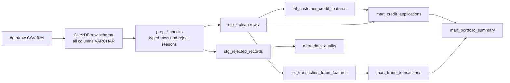

# Data lineage

Raw CSV files are loaded into DuckDB as text. dbt then types them, rejects bad rows, builds features, and publishes the tables a decision engine will read.

`stg_loan_performance` joins to the credit mart for the 12-month outcome. A blank outcome means the loan is too new to judge, or it was never booked. `outcome_status` on the mart says which.

Fraud windows read only transactions that staging kept, and only transactions earlier than the current row.
